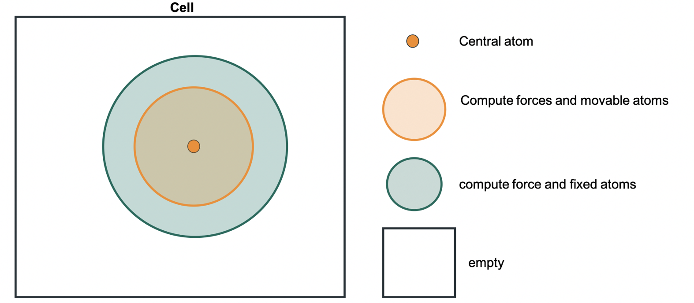

# Active Volumes

Active Volumes (AV) are used by the event searches and refinements when the two parameters `rmov` and `rbuff`
are set in the `[EventSearch]` section of the input file:

- `rmov`: radius (Angstrom) of the movable atoms around the central atom,
- `rbuff`: thickness (Angstrom) of the fixed buffer around the movable atoms.

The total radius of the AV is `rmov + rbuff`. Both parameters must be set together: if only one of them is
given, the input file is refused. If none is given (default), no AV is used.

Example:

```INI
[EventSearch]
style = partn
nsearch = 50
rmov = 15
rbuff = 6
```

*Note: the AV radius `rmov + rbuff` must be larger than `rcut` (`[AtomicEnvironment]`), otherwise the input file is refused.*

---

## General Idea

In very large systems with many defects, it can become memory intensive and slow to run event searches on the entire system. 
AV's define a region around a defect where searches and refinements will be performed without needing to use the entire system.
The AV has two parameters, the movable radius `rmov` and the buffer thickness `rbuff`. The movable radius is where atoms
are allowed to be moved during event searches and refinement. Around it, a frozen buffer of thickness `rbuff` is kept in
order to accurately model the forces between atoms near the boundary. All the atoms within `rmov + rbuff` of the central
atom are included in the AV.

<p align="center">
  
</p>

## Algorithm
1. **Reset LAMMPS Instance**: LAMMPS is cleared to prevent carry over of previous AV conditions
2. **AV Definition**: Find which atoms are to be included in AV, and which are movable
3. **Atom Map**: Create map between full system and AV system atom index's, types and positions
4. **AV Creation**: Atoms are created within AV

This then branches depending on if it is an Event Search step or Refinement step

**Event Search**: Event search continues the same as without AV's. Once results are obtained, the positions are mapped 
back to those of the full system.

**Refinement**: Unlike a non-AV refinement, the positions sent for refinement are not at the saddle point. First, the 
system in its current state is sent, the AV defined, then the potential energy `E_init` is calculated. This is needed as
regular refinements compare the saddle point energy to that of the full system, however in the AV the saddle point 
energy is in reference to that within the AV, not the full system. The event being refined is then applied to the atoms
saved in the local atomic environment, then the system is refined. The refined activation energy is then calculated from
`E_saddle - E_init` and the positions mapped back to the full system. 


If the movable radius `rmov` is less than the cut-off radius `rcut` for the local atomic environment, the refinements 
will fail. Similarly, if the active volume radius `rmov + rbuff` is less than `rcut`, the Event Searches will fail: this
case is refused when the input file is read.

The buffer thickness `rbuff` should be at least the cutoff of the potential. Otherwise, the movable atoms next to the
buffer do not see all their neighbors and experience improper forces. This can be fixed by increasing `rbuff`.

