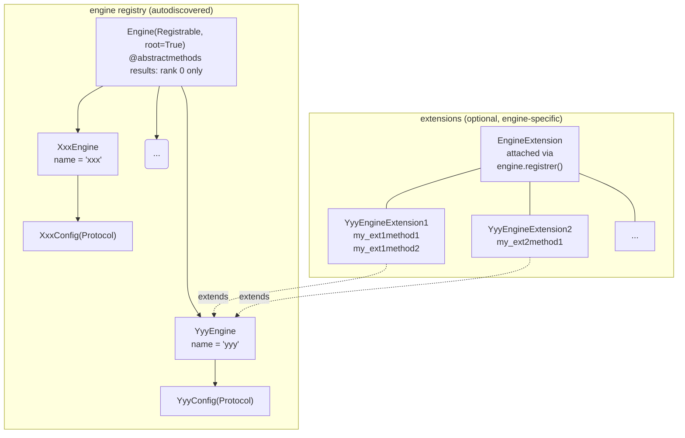

# Engine module

[TOC]

Engines are computational backends responsible for operations that require energy and force evaluations (e.g. minimization or event searches). The `Engine` module is designed to be used as the computation backend in the master-worker MPI structure provided by the `Manager` module _(see Manager documentation)_, and can also be used standalone. This primary use case within the Manager drives the key design choices of the module: `Engine` is a `Registrable` ABC with mandatory abstract methods, and data-extraction methods return results only on MPI rank 0 of the engine's communicator.

In addition to the mandatory interface, engines can be extended with operation-specific capabilities through the **extension mechanism** (see [EngineExtension](#engineextension)). This is the intended integration point when a higher-level algorithm needs to delegate a specific computation to the engine directly, for example, a CNA filter that uses a LAMMPS compute instead of the default Python implementation.



## Details

### Engine ABC

`Engine` inherits from `Registrable` (with `root=True`), which provides the registry and the autodiscovery mechanism shared across pyKMC modules. All subclasses must declare a `name` attribute and implement every abstract method. They represent the minimal set of operations required for the simulation.

```python
from pykmc._core import Registrable
from abc import abstractmethod


class Engine(Registrable, root=True):
    @abstractmethod
    def start(self) -> None: ...

    @abstractmethod
    def close(self) -> None: ...

    @abstractmethod
    def initialize_parameters(self) -> None: ...

    ...
```

**Rank 0 convention.** When running under MPI, all engine commands execute collectively across all ranks, but data-extraction methods return values only on rank 0 and all other ranks return `None`. Code calling these methods must account for this:

### Config Protocol

Each engine declares its own configuration interface as a `Protocol`. This keeps the engine decoupled from any concrete config class. It only requires that the config object exposes the expected attributes, without enforcing how it is built. In practice pyKMC uses Pydantic `BaseModel`s as configs, which are structurally compatible with any matching `Protocol`. The engine can therefore be instantiated with a Pydantic model in production or a plain stub in tests, as long as the interface matches.

```python
from typing import Protocol


class MyEngineConfig(Protocol):
    pair_style: str
    pair_coeff: list[str]
    min_style: str
    minimize: str
    verbosity: int
```

### EngineExtension

`EngineExtension` allows attaching engine-specific operations to an engine instance without modifying the `Engine` ABC. An extension registers itself at construction time by calling `super().__init__(engine)`, which calls `engine.register(self)` and stores the engine reference as `self.engine`. The engine then exposes the extension's public methods directly through `__getattr__` delegation, so callers access them as if they were native engine methods. Extension methods are also fully discoverable: they appear in `dir(engine)` and in `inspect.getmembers(engine, callable)` alongside the core methods.

```python
from pykmc.engine import EngineExtension, Engine

class MyExtension(EngineExtension):
    def __init__(self, engine: Engine, param: float):
        super().__init__(engine)   # required 
        self.param = param

    def new_compute(self, ...) -> list: ...
        # self.engine gives full access to the engine 
```

Once attached, the method is accessible directly on the engine instance:

```python
engine = Engine(name="myengine", config=cfg)
MyExtension(engine, param=...)  # attaches on construction

result = engine.new_compute(...)  # delegates to the extension
```

Conflicts are caught at registration time: if two extensions expose a method with the same name, `register()` raises a `ValueError`.

### Distinction from strategies

Although `Engine` uses the same `Registrable` autodiscovery mechanism as strategies, the two serve fundamentally different roles. Strategies are interchangeable algorithmic choices for a given operation; engines are fixed computational backends. An engine is not selected as one option among many equivalent alternatives.

## Adding a new engine

**1.** Create `pykmc/engine/my_engine.py`.

**2.** Define a config Protocol and an engine class:

```python
from typing import Protocol
import numpy as np
from .base import Engine


class MyEngineConfig(Protocol):
    my_param: str


class MyEngine(Engine):
    name = "my_engine"

    def __init__(self, config: MyEngineConfig, comm=None, engine_id: int = 0):
        super().__init__()
        self.config = config
        self.comm = comm
        self.engine_id = engine_id

    def start(self) -> None: ...
    def close(self) -> None: ...

    ...
```

No other steps are needed. `autodiscover` imports all submodules of `pykmc/engine/` when the package is loaded, which triggers `Registrable.__init_subclass__` and registers `MyEngine` under `"my_engine"` automatically.