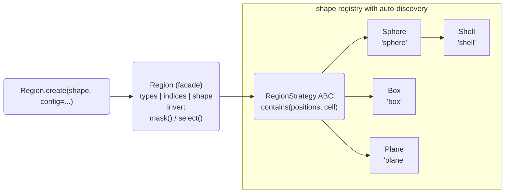

# Region module

[TOC]

The `Region` module selects atoms by chemical type, by index, or by a geometric shape (sphere, shell, box, plane). It answers a single question: _given the current positions, which atoms belong to this region?_

## Why this module exists

Several parts of pyKMC need to select a subset of atoms:

- `[inactive_atoms]`: atoms on which no event search can be centered.
- `[frozen_atoms]`: atoms held fixed (`fix setforce 0.0 0.0 0.0`) during event searches and refinements.
- Active volumes: the atoms around a central atom that are simulated, split into movable atoms and a frozen buffer.

The module follows the [facade/strategy architecture](dev_strategy_pattern.md): each shape is a strategy.
## Architecture



```
pykmc/region/
  region.py             # Region facade
  strategies/
    base.py             # RegionStrategy(Registrable, root=True)
    sphere.py           # Sphere, SphereConfig
    shell.py            # Shell(Sphere), ShellConfig
    box.py              # Box, BoxConfig
    plane.py            # Plane, PlaneConfig
```

The responsibilities are split as follows:

- A **strategy** (`RegionStrategy`) only answers the geometric question: `contains(positions, cell=None)` returns a boolean mask of shape `(N,)`.
- The **facade** (`Region`) combines the shape with selection by `types` and `indices`, and applies the `invert` flag.

## Usage

From the input file, `AtomicEnvironment.compute_region` passes the `RegionConfig` (`[inactive_atoms]`/`[frozen_atoms]`) directly to `Region.create(config.region_type, config=config, types=..., indices=..., invert=config.side == "outside")`; `shape=None` selects by `types`/`indices` only. From code, `Region.create` with the shape's `Params` dataclass (`SphereParams`, `ShellParams`, `BoxParams`, `PlaneParams`). Each shape checks its parameters when it is built:

```python
from pykmc.region import Region, SphereParams

# Active volume: sphere of radius ract around the central atom, with periodic boundary conditions
region_av = Region.create(
    "sphere", config=SphereParams(center_atom=12, radius=ract)
)
av_idx = region_av.select(positions, cell=cell)
```

See `define_AV` in `pykmc/activevolume/active_volume.py`: the movable atoms and the buffer are then split by their distance to the central atom.

### `mask` and `select`

| Method | Returns |
|---|---|
| `mask(positions, atom_types=None, cell=None)` | `np.ndarray[bool]` of shape `(N,)` |
| `select(positions, atom_types=None, cell=None)` | sorted `list[int]` of selected indices |

`atom_types` is required only when the region selects by `types`, otherwise a `ValueError` is raised.

## Selection rules

**Union.** An atom is selected if its type is in `types`, OR its index is in `indices`, OR it is in the shape. `shape` also accepts a list of strategies: the atom is then selected if it is in at least one of them. For anything more complex (intersection, per-shape inversion), combine the masks of several `Region` yourself.

**Inversion.** `invert=True` (`side = outside` in the input file) selects the atoms outside the shape (outside all of them for a list). It applies to the shape only, never to `types` and `indices`.

**Bounds are included**, except the inner bound of a shell: a sphere of radius `r1` and a shell `(r1, r2)` split a sphere of radius `r2` without overlap.

**Shapes.**

| Shape | Config attributes | Inside when |
|---|---|---|
| `sphere` | `center` or `center_atom`, `radius` | `d <= radius` |
| `shell` | `center` or `center_atom`, `radius`, `inner_radius` | `inner_radius < d <= radius` |
| `box` | `lo`, `hi` | `lo <= x, y, z <= hi` |
| `plane` | `normal` (`x`, `y`, `z`), `threshold`, `side` (`above`, `below`) | coordinate `>=` (above) or `<=` (below) `threshold` |

For a plane, `side` chooses the half-space and is read by the strategy itself; `outside` is not allowed.

**Periodic boundary conditions.** Without `cell`, positions are used as they are. With `cell` (shape `(3, 3)`), periodicity is applied in the three directions:

- `sphere` and `shell` use the minimum image distance to the center;
- `box` and `plane` first wrap the positions back into the cell, so the box or the plane is expected to lie inside the cell.

## Adding a shape

**1.** Create `pykmc/region/strategies/my_shape.py`:

```python
from typing import Protocol

import numpy as np

from .base import RegionStrategy


class MyShapeConfig(Protocol):
    my_param: float


class MyShape(RegionStrategy):
    name = "my_shape"

    def __init__(self, config: MyShapeConfig) -> None:
        self.config = config

    def contains(self, positions: np.ndarray, cell: np.ndarray | None = None) -> np.ndarray:
        """Return True for positions inside the shape."""
        ...
```

`Region.create("my_shape", config=...)` works immediately, with no other step.

**2.** To make the shape available from the input file, add `"my_shape"` to `RegionConfig.region_type`, add its parameters to `RegionConfig` and their checks to `RegionConfig.check_fields` in `pykmc/config.py`, then regenerate `docs/parameters_details.md`.

**3.** Add tests in `tests/region/`, including a case at the bound and a case with `cell`.
