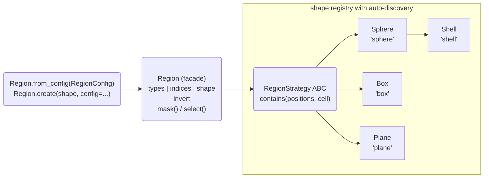

# Region module

[TOC]

The `Region` module selects atoms by chemical type, by index, or by a geometric shape (sphere, shell, box, plane). It answers a single question: _given the current positions, which atoms belong to this region?_

## Why this module exists

Several parts of pyKMC need to select a subset of atoms:

- `[inactive_atoms]`: atoms on which no event search can be centered.
- `[frozen_atoms]`: atoms held fixed (`fix setforce 0.0 0.0 0.0`) during event searches and refinements.
- Active volumes: the atoms around a central atom that are simulated, split into movable atoms and a frozen buffer.

Before this module, the selection logic lived in `pykmc/environments/region.py`, as a function reachable only through `AtomicEnvironment(style="region")`, and active volumes reimplemented their own spherical selection with periodic boundary conditions. `pykmc/region/` gathers this logic in one place, so that every consumer shares the same shapes, the same conventions (bounds, periodicity, inversion) and the same tests.

The module follows the [facade/strategy architecture](dev_strategy_pattern.md): each shape is a strategy, so a new shape (cylinder, slab, ...) is one new file.

## Architecture



```
pykmc/region/
  region.py             # Region facade
  strategies/
    base.py             # RegionStrategy(Registrable, root=True)
    sphere.py           # Sphere, SphereConfig
    shell.py            # Shell(Sphere), ShellConfig
    box.py              # Box, BoxConfig
    plane.py            # Plane, PlaneConfig
```

The responsibilities are split as follows:

- A **strategy** (`RegionStrategy`) only answers the geometric question: `contains(positions, cell=None)` returns a boolean mask of shape `(N,)`.
- The **facade** (`Region`) combines the shape with selection by `types` and `indices`, and applies the `invert` flag.

## Usage

### From the configuration

`[inactive_atoms]` and `[frozen_atoms]` are parsed into a `RegionConfig`. `Region.from_config` builds the matching facade:

```python
from pykmc.region import Region

region = Region.from_config(config.frozen_atoms)
frozen = region.select(system.positions, system.types)  # sorted list of indices
mask = region.mask(system.positions, system.types)  # boolean array (N,)
```

The corresponding input file section:

```ini
[frozen_atoms]
region_type = sphere
region_center_atom = 42   # or region_center = 5.0 5.0 5.0, not both
region_radius = 6.0
side = outside            # select the atoms outside the sphere
types = O                 # and every O atom, wherever it is
```

### From code

`Region.create` builds a region without a `RegionConfig`. The shape's config only has to expose the attributes declared by its `Protocol`, so a `SimpleNamespace` or a dataclass is enough:

```python
from types import SimpleNamespace
from pykmc.region import Region

# Sphere of radius 6 Å around atom 12, with periodic boundary conditions
around = Region.create("sphere", config=SimpleNamespace(center_atom=12, radius=6.0))
inside = around.mask(positions, cell=cell)

# Buffer of an active volume: shell between rmov and ract
buffer = Region.create(
    "shell",
    config=SimpleNamespace(center_atom=12, radius=ract, inner_radius=rmov),
).select(positions, cell=cell)
```

A strategy can also be used alone when only the geometry is needed:

```python
from pykmc.region import RegionStrategy

box = RegionStrategy.create("box", config=SimpleNamespace(lo=(0, 0, 0), hi=(5, 5, 5)))
mask = box.contains(positions)
```

### `mask` and `select`

| Method | Returns |
|---|---|
| `mask(positions, atom_types=None, cell=None)` | `np.ndarray[bool]` of shape `(N,)` |
| `select(positions, atom_types=None, cell=None)` | sorted `list[int]` of selected indices |

`atom_types` is required only when the region selects by `types`, otherwise a `ValueError` is raised.

## Selection rules

**Union.** An atom is selected if its type is in `types`, OR its index is in `indices`, OR it is in the shape. `shape` also accepts a list of strategies: the atom is then selected if it is in at least one of them. For anything more complex (intersection, per-shape inversion), combine the masks of several `Region` yourself.

**Inversion.** `invert=True` (`side = outside` in the input file) selects the atoms outside the shape (outside all of them for a list). It applies to the shape only, never to `types` and `indices`.

**Bounds are included.** An atom exactly on the sphere, on a box face or on the plane is inside.

**Shapes.**

| Shape | Config attributes | Inside when |
|---|---|---|
| `sphere` | `center` or `center_atom`, `radius` | `d <= radius` |
| `shell` | `center` or `center_atom`, `radius`, `inner_radius` | `inner_radius < d <= radius` |
| `box` | `lo`, `hi` | `lo <= x, y, z <= hi` |
| `plane` | `normal` (`x`, `y`, `z`), `threshold`, `side` (`above`, `below`) | coordinate `>=` (above) or `<=` (below) `threshold` |

For a plane, `side` chooses the half-space and is read by the strategy itself; `outside` is not allowed.

**Center of a sphere or shell.** Exactly one of `center` (fixed `[x, y, z]`) and `center_atom` (0-based index) must be set, both in `RegionConfig` and when the strategy is built. With `center_atom`, the center is read from the positions at each evaluation, so the region follows the atom.

**Periodic boundary conditions.** Without `cell`, positions are used as they are. With `cell` (shape `(3, 3)`), periodicity is applied in the three directions:

- `sphere` and `shell` use the minimum image distance to the center;
- `box` and `plane` first wrap the positions back into the cell, so the box or the plane is expected to lie inside the cell.

**Indices.** Values of `indices` outside `[0, N)` are ignored. A `center_atom` outside `[0, N)` raises an `IndexError`.

## Current integration

For now, `Region` is called through `AtomicEnvironment.compute_region`, which turns the mask into the `"in"`/`"out"` labels still read by `kmc.py` (`inactive_atoms`) and `engine/lammps.py` (`frozen_atoms`). The positions are passed without `cell`, which reproduces the behavior of the former `pykmc/environments/region.py` exactly.

Known limitations, to be addressed when atom selections move out of `AtomicEnvironment` (planned `State` object holding the frozen, inactive and active atoms):

- `"region"` is not a real atomic environment style: it is not selectable in `[AtomicEnvironment] style` and only encodes a selection as fake environment IDs.
- `inactive_atoms` is evaluated once, at initialization and on restart, while `frozen_atoms` is re-evaluated with the current positions at every engine call.
- Periodic boundary conditions are not applied to `inactive_atoms` and `frozen_atoms`.

## Adding a shape

**1.** Create `pykmc/region/strategies/my_shape.py`:

```python
from typing import Protocol

import numpy as np

from .base import RegionStrategy


class MyShapeConfig(Protocol):
    my_param: float


class MyShape(RegionStrategy):
    name = "my_shape"

    def __init__(self, config: MyShapeConfig) -> None:
        self.config = config

    def contains(self, positions: np.ndarray, cell: np.ndarray | None = None) -> np.ndarray:
        """Return True for positions inside the shape."""
        ...
```

`Region.create("my_shape", config=...)` works immediately, with no other step.

**2.** To make the shape available from the input file, add `"my_shape"` to `RegionConfig.region_type`, add its parameters to `RegionConfig` and their checks to `RegionConfig.check_fields` in `pykmc/config.py`, then regenerate `docs/parameters_details.md`.

**3.** Add tests in `tests/region/`, including a case at the bound and a case with `cell`.
