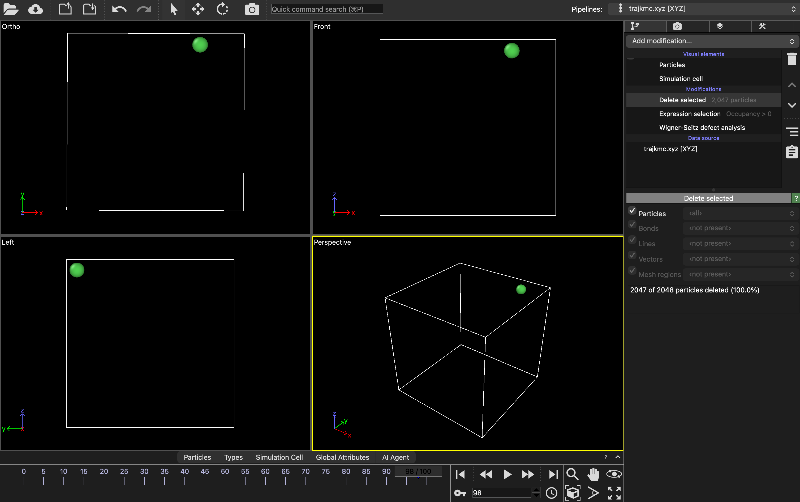

# Ni monovacancy

Goal: run 100 KMC steps, check the results and follow a vacancy in OVITO.

Prerequisite: a working environment from [Installation](../../installation/README.md). An existing local installation avoids scheduler queueing; both platforms are supported below.

## 1. Understand the system

This example has 2047 Ni atoms in a periodic 28.16 Å cube: an 8 × 8 × 8 FCC supercell with one atom removed. An atom filling the vacancy leaves its previous site empty, so the vacancy moves opposite to that atom.

Preparation reads `examples/Ni_fcc_2047at_monovacancy` from your installed pyKMC and copies:

| File | Purpose |
| --- | --- |
| `initial_config.xyz` | The defective starting structure. |
| `Ni_v6_2.0_LKBeland2016.eam` | The interatomic potential for LAMMPS energies and forces. |
| `input.in` | The settings you edit for this run. |

<a id="1-choose-your-route"></a>
<a id="prepare"></a>

## 2. Prepare a run

Choose one platform below. Commands assume the guide is at `~/pykmc-guide`; substitute your actual guide and installation paths if different. You can use Tab completion while entering paths ([path help](../../paths.md)). Keep the complete guide in place and let preparation create the new destination.

<a id="local"></a>

<details>
<summary>Local computer — activate and prepare</summary>

Use your local terminal; on Windows, use Ubuntu after the [WSL setup](../../installation/README.md#b-windows--wsl2--ubuntu).

On macOS, activate:

```bash
source ~/software/pyKMC_setup/pykmc_install/pykmc_env/bin/activate &&
unset PYTHONPATH
```

On Linux/WSL, activate your Linux installation instead:

```bash
source ~/software/pyKMC_setup/pykmc_install/activate.sh
```

Check that Python and MPI belong to the intended installation/toolchain:

```bash
command -v python mpirun
```

Python should be in this installation's `pykmc_env/bin/`. Resolve activation errors before preparing:

```bash
cd ~/pykmc-guide/examples/ni-monovacancy &&
bash scripts/prepare_example.sh \
  ~/software/pyKMC_setup/pykmc_install \
  ~/pykmc-runs/ni-monovacancy-01 &&
cd ~/pykmc-runs/ni-monovacancy-01 &&
ls -lh input.in initial_config.xyz Ni_v6_2.0_LKBeland2016.eam
```

The inputs are now together in `~/pykmc-runs/ni-monovacancy-01`. Open the settings:

```bash
nano input.in
```

</details>

<a id="trillium"></a>

<details>
<summary>Trillium — activate and prepare</summary>

Use the installation and complete guide from [Trillium setup](../../installation/README.md#c-trillium). These commands run in your SSH terminal:

```bash
module load StdEnv/2023 gcc/12.3 openmpi/4.1.5 python/3.12.4 mpi4py/4.1.0 cmake/3.31.0 &&
source "$SCRATCH/pyKMC_install/pykmc_install/activate.sh" &&
command -v python
```

Keep the module-provided `PYTHONPATH`. After successful activation:

```bash
cd ~/pykmc-guide/examples/ni-monovacancy &&
bash scripts/prepare_example.sh \
  "$SCRATCH/pyKMC_install/pykmc_install" \
  "$SCRATCH/pykmc-runs/ni-monovacancy-01" &&
cd "$SCRATCH/pykmc-runs/ni-monovacancy-01" &&
ls -lh input.in initial_config.xyz Ni_v6_2.0_LKBeland2016.eam
```

This is the submission directory. Open the settings:

```bash
nano input.in
```

</details>

Preparation also saves `input.in.upstream` and `guide-preflight.py` automatically. It leaves numerical settings unchanged. Apply the input checklist below before launching. In nano, save with Ctrl+O, Enter, then exit with Ctrl+X.

<a id="2-understand-the-inputs"></a>
<a id="input"></a>

## 3. Input checklist

Example parameters are under maintainer review. Required run settings are listed below; [validation](../../maintenance/validation.md#current-input-settings) records numerical settings and source versions. Preparation copies the installed input unchanged.

### Required files and run layout

Open `input.in` and check:

| Setting | Requirement for this walkthrough |
| --- | --- |
| `initial_config` | `./initial_config.xyz`, matching the prepared file. |
| `[Lammps] pair_style`, `pair_coeff` | `eam/alloy` and `* * ./Ni_v6_2.0_LKBeland2016.eam Ni`. |
| `n_steps` | `100`: the teaching length used by the result checks, measured in KMC steps rather than MD timesteps. |
| `basin`, `active_volume`, `recycle` | `False` for this introductory run. |

Use `engine = lammps`, `n_sessions = 7`, `engine_use_rank_0 = False` and the default `group_size = -1` with the supplied 8-process launcher. For a new run, leave restart and imported catalog paths unset. Set feature switches in `[Control]`; a section heading alone does not enable a feature.

### Understand the physical parameters

The prepared input supplies the current values. Read them before running; the definitions below explain what they control.

| Parameter | Purpose |
| --- | --- |
| `min_style`, `minimize` | Structural relaxation method, convergence tolerances and iteration/evaluation limits. |
| `[AtomicEnvironment] style = cna/graph`, `rnei`, `rcut` | [Common Neighbor Analysis](../../glossary.md#cna) and graph-based environment recognition. `rnei` sets the neighbor cutoff; `rcut` sets the environment radius. These are separate from the potential's interaction cutoff. |
| `[EventSearch] style = partn`, `nsearch` | Use pARTn to search for transitions; `nsearch` sets attempts per new environment. Some attempts fail or find equivalent events. |
| `emin_event`, `emax_event` | Accepted activation-barrier range in eV. |
| `[RateConstant] style = constant`, `k0`, `T` | Constant attempt-frequency prefactor in ps⁻¹ and temperature in K. Event rates still depend on the barrier: `k = k0 exp(-Ea/kBT)`. |
| `[PSR]` / `[IRA]` | [Point Set Registration / IRA](../../glossary.md#psr-and-ira) aligns structures for event matching and reuse. |

pyKMC searches transitions between energy minima, assigns rates and selects events. The trajectory records event endpoints; vibration and saddle-search motion are not included.

<a id="run"></a>

## 4. Run

Both routes use 8 MPI processes and 7 worker sessions. The launcher checks inputs and protects existing results. For a local run, provide 8 available MPI CPU slots; physical cores and logical threads can differ, particularly under WSL. Review the layout before using a smaller machine rather than forcing oversubscription.

<details>
<summary>Local computer — launch and check the exit</summary>

```bash
cd ~/pykmc-runs/ni-monovacancy-01 &&
bash ~/pykmc-guide/examples/ni-monovacancy/local/run-local.sh
```

Keep the terminal open and computer awake. On macOS, you can replace the `bash` line with `caffeinate -i bash ~/pykmc-guide/examples/ni-monovacancy/local/run-local.sh` to prevent idle sleep; leave the lid open.

When the command returns:

```bash
cat run-exit-status.txt
tail -n 20 pykmc.log
tail -n 5 pykmc.out
```

Expect status `0`. Launch output is in `run.log`; software records are in `run-versions/`. The printed `real` is elapsed computer time. Continue with the result checks below from this directory.

</details>

<details>
<summary>Trillium — submit, monitor and download</summary>

Copy the [Slurm script](trillium/ni-monovacancy.sbatch) to the submission directory:

```bash
cd "$SCRATCH/pykmc-runs/ni-monovacancy-01" &&
cp ~/pykmc-guide/examples/ni-monovacancy/trillium/ni-monovacancy.sbatch job.sbatch
```

Open it and set `--account` to your allocation, `--mail-user` to your own email address, and `PYKMC_ROOT` to your cluster installation path. The supplied `--mail-type=BEGIN,END,FAIL` requests email notifications when the job starts, finishes or fails:

```bash
nano job.sbatch
bash -n job.sbatch
grep -nE 'YOUR_|/ABSOLUTE' job.sbatch
```

Both checks should print nothing; grep's exit status 1 means no placeholders matched. Keep the supplied process/session layout. The script's `00:15:00` limit is a maximum wall-time allowance, adjustable for your workload and current site policy. Resolve errors and placeholders before continuing.

With the same pyKMC environment active, check the prepared input on the login node before joining the queue. This reads the configuration and checks required files and the chapter's process layout; it does not start MPI or a simulation. Expect `PASS` before submission. The job repeats the check when it starts.

```bash
python -B guide-preflight.py --example ni-monovacancy &&
sbatch job.sbatch
```

Replace `JOBID` in the commands below with the number returned by Slurm:

```bash
squeue -j JOBID
sacct -j JOBID --format=JobID,State,ExitCode,Elapsed
```

Pending means the job is waiting. After it finishes, expect `COMPLETED` / `0:0`. Inspect the Slurm logs and enter the result directory:

```bash
cd "$SCRATCH/pykmc-runs/ni-monovacancy-01" &&
tail -n 30 slurm-JOBID.out &&
tail -n 30 slurm-JOBID.err &&
cd run-JOBID &&
cat run-exit-status.txt
```

Expect status `0`. Slurm logs stay in the submission directory; simulation outputs are in `run-JOBID/`. Run the chapter's result checks there with the same environment active.

For local OVITO, run `pwd` inside the remote result directory. Then use a separate local terminal to download it. Replace the username and remote path below with your own; choose a destination that does not exist:

```bash
mkdir -p ~/pykmc-results
test ! -e ~/pykmc-results/ni-monovacancy-01-trillium &&
scp -r YOUR_USERNAME@trillium.alliancecan.ca:/absolute/remote/path/run-JOBID \
  ~/pykmc-results/ni-monovacancy-01-trillium
```

Preserve `job.sbatch` and the parent Slurm logs too. To run the Python checks locally, activate local pyKMC and enter the downloaded directory. OVITO can open the downloaded trajectory directly.

</details>

If interrupted, keep the directory and logs; wait for local MPI processes to stop before another attempt. A timeout or cancellation may leave no exit-status file. See [interrupted runs](../../faq.md#what-if-i-stop-a-run) for recovery boundaries. Each new attempt uses a new directory.

<a id="3-check-the-completed-run"></a>
<a id="results"></a>

## 5. Check the completed run

Work in the result directory with pyKMC active. For local runs this is the directory you prepared; for Trillium it is `run-JOBID/` or its downloaded copy.

1. Check successful termination: local `run-exit-status.txt` contains `0`, or Slurm reports `COMPLETED` with exit `0:0`. Local launcher output is in `run.log`; Slurm output is in the parent submission directory's `slurm-JOBID.out/.err`.
2. Open `pykmc.log` and look for `End of simulation`; open `pykmc.out` and check that the final step is 100.
3. Run the result checker:

```bash
python ~/pykmc-guide/examples/ni-monovacancy/scripts/check_ni_run.py trajkmc.xyz --steps 100 \
  --progress pykmc.out --reference ~/pykmc-guide/examples/ni-monovacancy/Ni_fcc_perfect_2048_reference.xyz
```

With the supplied step count and output settings, expect 101 frames, 2047 Ni atoms per frame, finite coordinates, a fixed periodic cell, increasing KMC time, one vacant site and no excess atoms. Other step counts, restart/appended trajectories or changed output intervals require corresponding checks.

The successful checker includes:

```text
PASS: 101 readable frames; each has 2047 Ni atoms, finite positions, fixed periodic 28.16 A cell
PASS: nearest-reference-site counts: one vacancy, zero excess atoms in every frame
PASS: progress steps 0..100, finite values and increasing KMC time
```

| Output | What to examine |
| --- | --- |
| `pykmc.log` | Workflow, environments, active events and termination. |
| `pykmc.out` | The selected event, barrier, rates, system energy and elapsed KMC time; columns are explained below. |
| `pykmc.info` | Search/refinement successes, failures and filtering. |
| `pykmc.events` | Available and selected events; reference-event IDs are not atom IDs. |
| `trajkmc.xyz` | Recorded atom configurations. |
| `artn.out.*`, `lammps.log.*` | Detailed engine/search diagnostics. |
| Restart and `.pickle` files | Preserve for possible recovery; do not unpickle untrusted data. Restart is outside this walkthrough. |

### Read the progress table

Row 0 is the initial state. In this basin-disabled run, row `i` describes the event from trajectory frame i−1 to frame i. Check the file header when using another software version.

```text
Step  dT(s)  T(s)  Ref event  Ea(eV)  k_evt(ps-1)  k_tot(ps-1)  E(eV)  Cpu time(s)  Wall time(s)
```

| Column | Meaning |
| --- | --- |
| `Step` | KMC step number. |
| `dT(s)` | Sampled physical waiting time for this step. |
| `T(s)` | Cumulative simulated time; T here is not temperature. |
| `Ref event` | Selected reference-event ID, not an atom ID. |
| `Ea(eV)` | Selected forward activation barrier, not the system's total energy. |
| `k_evt(ps-1)` | Rate of the selected individual channel. |
| `k_tot(ps-1)` | Sum of rates over the currently included active channels. |
| `E(eV)` | System potential energy after the event. |
| `Cpu time(s)` | CPU time used by the process recording this step, not summed over all MPI ranks. |
| `Wall time(s)` | Elapsed computational time measured within this step. |

CPU and wall timings measure computation for each step. The launcher's whole-run timer also includes startup and shutdown; KMC physical time is reported separately in `dT(s)` and `T(s)`.

For a given state, `k_tot` is the sum of the available channel rates, and a channel's selection probability is `k_evt / k_tot`. The [SIA chapter](../ni-fcc-sia/README.md#6-read-barriers-rates-and-physical-time) later connects these values to sampled waiting times in more detail.

Individual saddle searches, including those ending in `EIGENVALUE LOST`, can fail while other searches supply valid events. Assess the exit, refinement results and trajectory together. Random event choices and waiting times vary between runs; catalog completeness is a separate scientific check.

<a id="4-visualize-the-vacancy-in-ovito"></a>
<a id="visualization"></a>

## 6. Visualize the vacancy in OVITO

Load `trajkmc.xyz` and use the supplied [perfect reference](Ni_fcc_perfect_2048_reference.xyz) for [Wigner–Seitz (WS) analysis](../../glossary.md#wignerseitz-analysis). It contains 2048 ideal sites aligned with this 28.16 Å FCC Ni cell. The reference is ready to use; a different cell, origin or orientation needs a matching reference.

1. Open `trajkmc.xyz` as the main source and confirm frames 0–100. Enable multiple-timestep import if necessary.
2. Disable old displacement/color-coding modifiers for this view.
3. Add Wigner–Seitz defect analysis. Select External file and load `Ni_fcc_perfect_2048_reference.xyz` from this guide.
4. Select Sites output; leave per-type occupancy off. No affine mapping is needed for this matching fixed cell.
5. Check vacancy count 1 and interstitial count 0 before filtering the display.
6. Add Expression selection, enter `Occupancy > 0`, then add Delete selected.
7. Step through the trajectory. Only the empty-site marker should remain. Save the OVITO state (`.ovito`) and keep its source files accessible.

The sphere marks an empty reference site, not an atom. Its color has no intrinsic defect meaning; four viewports show four views of the same site. Modifiers do not delete particles from the source file. See [OVITO WS documentation](https://www.ovito.org/manual/reference/pipelines/modifiers/wigner_seitz_analysis.html).



Illustrative filtered view. Use it to compare the modifier sequence and defect count; your marker location will differ.

### Boundary crossings and back-jumps

Opposite faces connect under periodic boundaries. A short hop crossing a face is displayed on the opposite side of the box, which can look like a long jump. Use the minimum-image displacement, not direct subtraction of wrapped coordinates.

A subsequent opposite hop may return the vacancy to its previous site. That can be a valid back-jump. Playback frames are KMC steps with potentially different physical waiting times; movie speed is not atomic speed.

<a id="5-optional-inspect-which-atom-moved"></a>
<a id="atom-displacements"></a>

## 7. Optional: inspect which atom moved

Disable WS and the selection/deletion modifiers first: displacement analysis needs the actual atoms, not reference sites. Add Displacement vectors, use a reference relative to the current frame with offset −1, enable the minimum-image convention and start at frame 1. Color-code displacement magnitude or display arrows; keep the color range fixed. See [OVITO displacement documentation](https://www.ovito.org/manual/reference/pipelines/modifiers/displacement_vectors.html).

Large-displacement colors identify moving atoms, not vacancies. Comparing every frame with frame 0 instead shows accumulated net displacement and can highlight many previously moving atoms. The ideal vacancy-site hop distance and relaxed atom displacement need not be identical.

For a nearest-neighbor vacancy hop in this FCC reference, the site distance is `a/√2 = 3.52/√2 ≈ 2.49 Å`; this is a geometry check, not an exact required displacement for the relaxed atom.

The shared checker also accepts `--pair START END` for consecutive frames and can compare two successive jumps. Choose frames from your own run; see its `--help`. With a reference supplied it reports vacancy-site coordinates and minimum-image displacement as well. Atom comparisons assume unchanged atom order. Long-range diffusion analysis needs a properly tracked/unwrapped path and more sampling; it is outside this first example.

<a id="6-troubleshooting-and-completion"></a>

## Troubleshooting

| Problem | First check |
| --- | --- |
| Missing input or potential | Current directory and relative paths in `input.in`. |
| Wrong Python, missing module or MPI error | Reactivate the matching environment; check the installation chapter before reinstalling anything. |
| Existing-output warning | Keep the old results and prepare a new run directory. |
| Nonzero exit, timeout or incomplete trajectory | Preserve logs and diagnose before rerunning; output files alone do not prove success. |
| Many WS vacancies/interstitials | Reference size/alignment, cell, PBC and Sites mode. |
| Unexpected colors or a cross-box jump | Active modifier, reference frame and periodic boundaries. |

## Completion criteria

The run exits successfully, structural/site checks pass, and you can explain the moving vacancy in OVITO. Keep inputs, versions, logs and the trajectory with your private run records.
